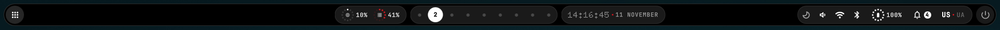
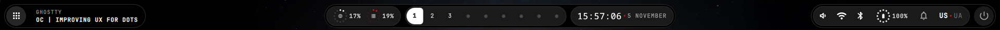

<div align="center">


<br>


# Edots

**Nook's MangoWM + Quickshell rice.**
Material 3 Expressive and Nothing — two designs, one wallpaper palette.

[](https://github.com/DreamMaoMao/mangowc)
[](https://quickshell.org)
[](LICENSE)

[**Full documentation →**](README.md) · [Features](README.md#-features) · [Gallery](README.md#-gallery) · [Install](README.md#-installation) · [Keybinds](README.md#-keybinds) · [Docs site](docs/index.html)

<br>


<sub><b>Material 3 Expressive</b> — tonal pills, dynamic colours</sub>

<br><br>


<sub><b>Nothing</b> — monochrome, dot-matrix rings, one red accent</sub>

<br><br>


<sub><b>Islands</b> — three floating capsules: control · workspaces + clock · tray</sub>

</div>

<br>

## What is Edots?

A full Wayland desktop built around a morphing Quickshell bar: a launcher,
dashboard, wallpaper picker, mixer, audio studio, display centre, notification
daemon, lock screen and settings window. One palette generated from the current
wallpaper repaints the bar, GTK, terminals, Firefox, rofi and KDE.

## Highlights

| | |
|---|---|
| 🎨 **Two designs** | Material 3 Expressive and Nothing, light and dark, switchable live. |
| 🧩 **Modular bar** | Full strip, compact pill or three floating islands, on any edge and per monitor. In Morph mode the panel grows out of the bar — from the clicked module, the pill itself, or each island capsule independently. |
| 🔔 **Notifications** | Own daemon: popups, center, unread state, pin, snooze, per-app mute, search, filters, copy, clear-read and Do Not Disturb. |
| 🪄 **Surfaces** | Launcher, wallpapers, clipboard, mixer, audio, display, Wi-Fi, media, power, updates, keybinds. |
| 🔎 **Advanced launcher** | Apps, files, calculator, emoji and shell commands in one field. |
| 📊 **Dashboard** | Weather, resources, media, workspaces and a planner. |
| 🎚 **Audio studio** | 10-band EQ, presets, bypass and RNNoise mic cleanup via EasyEffects. |
| 🔀 **Per-app audio** | Per-app volume, mute and pinned output devices. |
| 🖥 **Display centre** | Resolution, refresh, scale, rotation and layout with an 18-second safety rollback. |
| 🎥 **Screen tools** | Screenshot, region OCR, Google Lens and recording in the bar. |
| 🌙 **Night light** | Warm the screen with `gammastep` — manual or a sunrise/sunset schedule. |
| ⬆️ **Update centre** | Non-locking repo/AUR/Flatpak check; updates run in a terminal. |
| 🔒 **Lock screen** | Quickshell + PAM, ken burns, parallax, power menu, lock-before-suspend, optional Face ID. |
| 🌙 **Idle & session** | Lock, display-off and suspend timers written live to `swayidle`. |
| 🧱 **Plugins** | Drop in a folder with `plugin.json` for a panel, a bar module, or both. |
| 🩺 **`edots` CLI** | Every surface plus `edots doctor` for a full health check. |

## Quick start

```sh
git clone https://github.com/Edgit13/Dotfiles ~/Dotfiles
cd ~/Dotfiles && ./install.sh
```

Then log out and back in, and check the install:

```sh
edots doctor
```

See the [main README](README.md) for requirements, all keybinds, IPC, the colour
system, plugin authoring and the repository layout.

<br>

<div align="center">

**Made by [Nook](https://github.com/Edgit13) · MIT**

</div>
