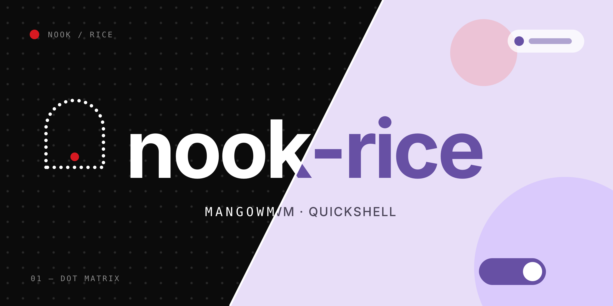
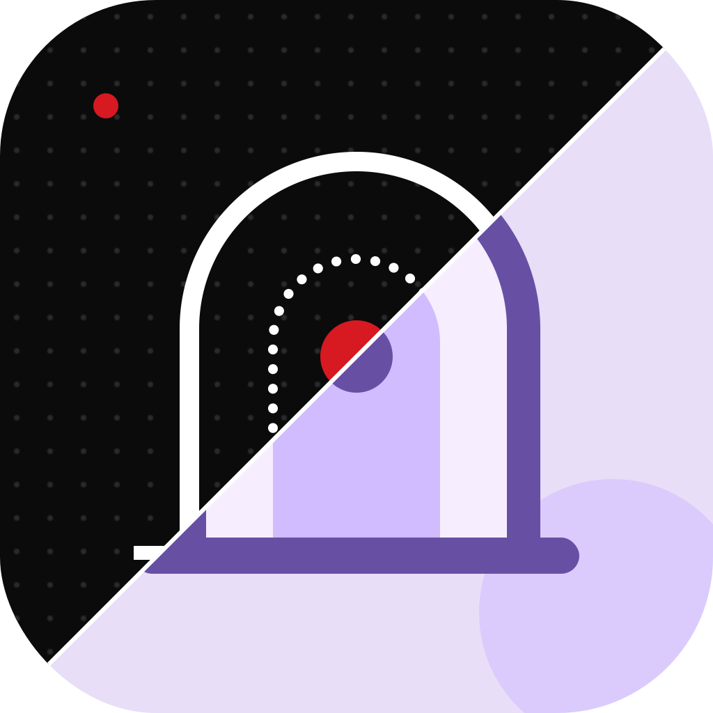
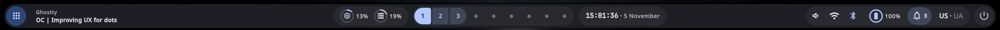
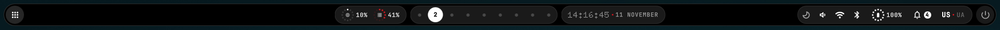
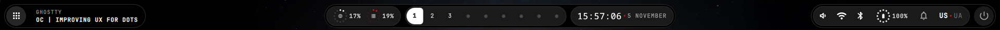
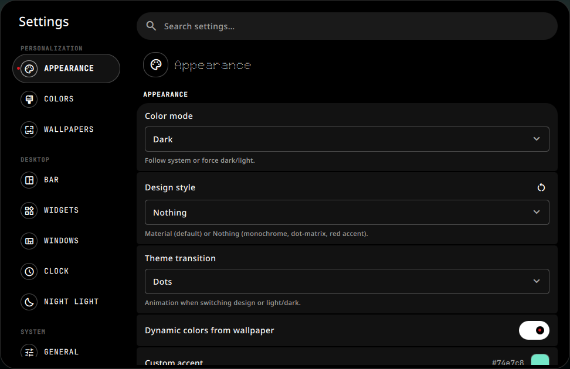
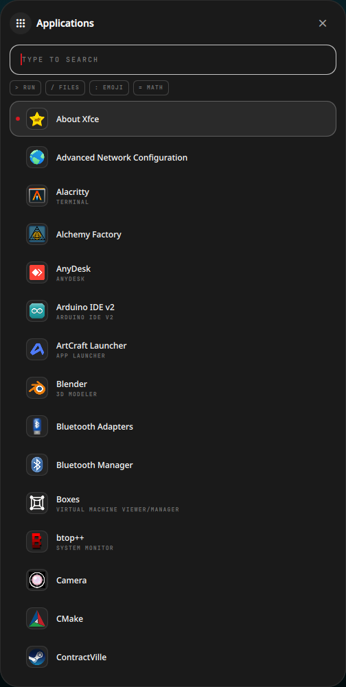
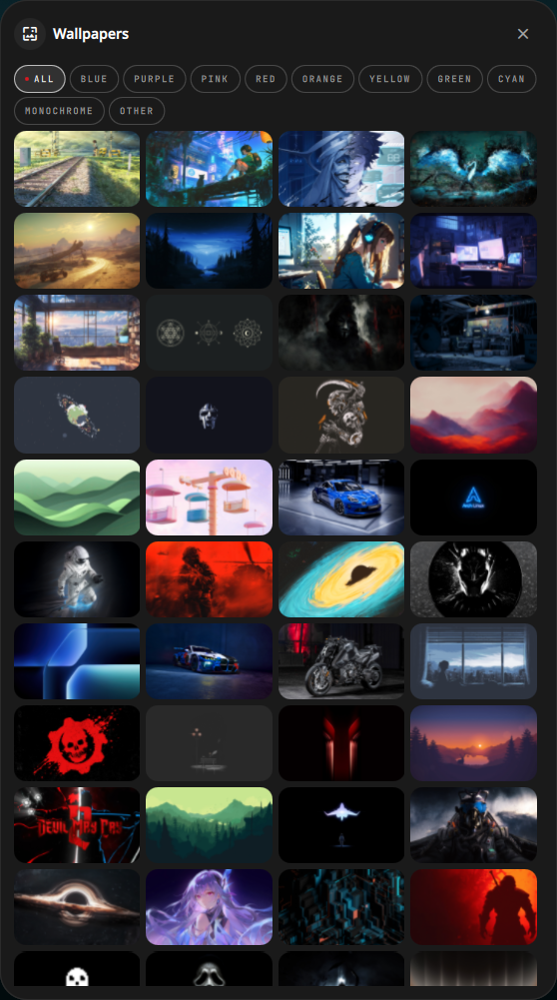

<div align="center">



<br>



# Edots

**A MangoWM + Quickshell rice by [Nook](https://github.com/Edgit13)**
Two designs — **Material 3 Expressive** and **Nothing** — one palette from your wallpaper.

[](https://github.com/DreamMaoMao/mangowc)
[](https://quickshell.org)
[](https://github.com/Edgit13/Dotfiles)
[](LICENSE)
[](https://github.com/Edgit13/Dotfiles/stargazers)
[](https://github.com/Edgit13/Dotfiles/actions/workflows/lint.yml)

[**Features**](#-features) · [**Gallery**](#-gallery) · [**Install**](#-installation) · [**Keybinds**](#-keybinds) · [**IPC**](#-ipc) · [**Colors**](#-color-system) · [**Docs**](docs/index.html) · [**Structure**](#-structure)

<br>


<sub><b>Material 3 Expressive</b> — tonal pills, dynamic colours from the wallpaper</sub>

<br><br>


<sub><b>Nothing</b> — monochrome, dot-matrix rings, one red accent</sub>

<br><br>


<sub><b>Islands</b> — three floating capsules: control · workspaces + clock · tray</sub>

</div>

<br>

> **Edots** is a complete Wayland desktop, not just a bar. A morphing Quickshell
> shell, a Material 3 dashboard, a custom lock screen and a palette engine that
> paints the whole system — GTK, terminals, Firefox, rofi, KDE — from a single
> wallpaper. Switch to **Nothing** and it becomes monochrome, dotted, quiet.

<br>

## ✨ Features

### 🖥 The shell

| | |
|---|---|
| 🎨 **Two designs** | Material 3 Expressive and Nothing, light and dark. Switch live in *Settings → Appearance* or with `ipc call theme toggleDesign`. Animated transitions: `fade`, `dots`, `scan` or off. |
| 🧩 **Modular bar** | Three designs — one full strip, a compact pill, or three floating **islands** — on any edge (top / bottom / left / right) and per monitor. Launcher, active window, media player, resources, workspaces, clock, volume, network, battery, notifications, power. Modules can be toggled from Settings. In **Morph** mode every style grows the panel out of the bar: the full strip from the clicked module, the pill from itself, and each island capsule independently. |
| 🫧 **Live capsule** | The pill is never just a clock: a new notification, a timer under 30 minutes or the track that is playing slides into it as one small chip — app icon, title, red dot for critical alerts, a tiny equalizer for music — then clears itself. A click opens the notification center, the timers or the media player. |
| 🪄 **Surfaces** | Launcher, wallpapers, clipboard, mixer, audio studio, display centre, Wi-Fi, media, power menu, updates, keybind cheat-sheet and resources open as floating cards next to the bar — on the monitor you are using. |
| 🔎 **Advanced launcher** | One field for everything: apps, files (`/report`), a calculator (`2+2`), emoji (`:fire`) and shell commands (`>htop`). <kbd>Enter</kbd> opens or copies, <kbd>Ctrl</kbd>+<kbd>Enter</kbd> runs a command in the terminal. |
| 📊 **Dashboard** | Overview, Media, Performance, Workspaces and Planner tabs. Weather (Open-Meteo, no API key), CPU / RAM / disk, brightness, volume, calendar with timed tasks. |
| 🔔 **Own notification daemon** | Popups and a notification center with unread state, pin, snooze, per-app mute, search, All / Unread / Pinned filters, copy text, clear-read, history limit, card density/icon size and Do Not Disturb. Block an app entirely or mark it priority (bypasses DND) from its group header; the same alerts can appear on the lock screen as a counter or a compact list with the text hidden by default. The bar bell expands into a live pill for new notifications. `swaync` is not required. |
| 🔒 **Lock screen** | Quickshell + PAM lock screen: ken burns, parallax, floating shapes, power buttons. Lock-then-suspend through logind. Optional **Face ID** unlocks from the webcam; the password always works. |
| 🌙 **Idle & session** | Lock, display-off and suspend timers in *Settings → System → Session*; `swayidle` is regenerated live. `edots session` shows the effective timers and exposes lock / suspend / logout / reboot / poweroff. |
| 🧪 **Convert ring** | Select files in your file manager and press <kbd>Super</kbd>+right click: a ring opens at the pointer — pictures (PNG/JPG/WebP/AVIF/GIF/ICO), video (MP4/WebM/MKV/GIF) or sound (MP3/WAV/FLAC/OGG/M4A), each with an estimate of the result's size before you commit. Files land in a `Converted` folder next to the originals; video can also be pulled out as sound. Pictures go through ImageMagick, video and sound through ffmpeg (NVENC when it really works). |
| 🔐 **Polkit agent** | Privileged actions (`pkexec`, updates, mounting disks) ask for the password in an Edots dialog on the monitor you are using — the same Material 3 / Nothing card, <kbd>Enter</kbd> confirms, <kbd>Esc</kbd> cancels, a wrong password lets you retry. No `polkit-gnome` needed; the shell registers itself with polkitd. |
| 🔊 **OSD** | Volume and brightness overlays on the active monitor. |
| 🎮 **Game mode** | One switch turns off blur, animations and effects; the bar shows a pill while it is active. |

### 🎚 Sound

| | |
|---|---|
| 🎛 **Mixer** | Master volume, per-application streams, output and input devices, ports and mute — all in one surface. |
| 🎚 **Audio studio** | 10-band equalizer with presets and preamp, global bypass and RNNoise microphone noise reduction. Runs through EasyEffects; <kbd>Super</kbd>+<kbd>Shift</kbd>+<kbd>X</kbd> or `edots audio`. |
| 🔀 **Per-app audio** | Mixer → Apps shows every playing app with its own volume, mute and output device. Pin an app to a sink and Edots remembers it for next time; unpin to follow the system default. `edots app-audio` manages the same routes from the terminal. |

### 🧰 System & workflow

| | |
|---|---|
| 🖥 **Display centre** | Per-output on/off, resolution, refresh rate, scale, rotation, arrangement and adaptive sync. Every apply asks you to keep it, otherwise the previous layout returns after 18 seconds. <kbd>Super</kbd>+<kbd>Shift</kbd>+<kbd>E</kbd> or `edots display`. |
| 🖼 **Wallpapers by color** | The picker sorts your wallpapers into Blue / Purple / Pink / Red / Orange / Yellow / Green / Cyan / Monochrome. Files are never touched; the index lives in `~/.cache/quickshell`. |
| ⚙️ **Settings app** | A separate window with live controls, search across every option and a ↺ reset on each control. Persisted to `~/.config/quickshell/*.json`. |
| 🧱 **Plugins** | Drop a folder with `plugin.json` into `~/.config/edots/plugins` to add a surface panel, a bar module, or both. Enable, inspect and reload them in *Settings → Plugins*; `edots plugin` lists them and `edots plugin open <id>` opens a panel. The bundled World Clock is a complete example. |
| 🎥 **Screen tools** | Screenshot / region OCR / Google Lens / recording overlay, all in the bar shell (screentool) with a recording indicator. <kbd>Super</kbd>+<kbd>U</kbd>, `edots ocr`, `edots lens`. |
| 🌙 **Night light** | Warm the screen with `gammastep` — manual temperature or an automatic sunrise/sunset schedule, from the bar, Settings or `edots nightlight`. |
| 🟢 **Privacy indicators** | An Android-style green dot in the bar while an app is using the camera or microphone — with the app names on hover. Catches PipeWire captures and apps that open `/dev/video*` directly; toggle in Settings → Modules. |
| ⬆️ **Update centre** | Non-locking check of repo, AUR and Flatpak updates (`checkupdates`, `yay/paru -Qum`, `flatpak remote-ls --updates`). "Update all" opens a terminal running `upkg update` — nothing installs silently. |
| 🌍 **Languages** | English and Ukrainian UI. |
| 🩺 **`edots` CLI** | One command for every surface — `edots launcher`, `edots settings`, `edots reload` — and `edots doctor` checks packages, fonts, links and services. |

<br>

## 🖼 Gallery

<table>
  <tr>
    <td width="58%" align="center" valign="top">
      
      <br><b>Dashboard</b>
      <br><sub><kbd>Super</kbd>+<kbd>D</kbd> — weather, resources, media and a planner</sub>
    </td>
    <td width="42%" align="center" valign="top">
      
      <br><b>Settings</b>
      <br><sub><kbd>Super</kbd>+<kbd>A</kbd> — every option, live and searchable</sub>
    </td>
  </tr>
</table>

<br>

<table>
  <tr>
    <td width="50%" align="center" valign="top">
      
      <br><b>Launcher</b>
      <br><sub><kbd>Super</kbd>+<kbd>Space</kbd> — fuzzy search over desktop entries, icons and categories</sub>
    </td>
    <td width="50%" align="center" valign="top">
      
      <br><b>Wallpaper selector</b>
      <br><sub><kbd>Super</kbd>+<kbd>C</kbd> — filter by dominant color; picking one recolors the whole system</sub>
    </td>
  </tr>
</table>

<br>

<table>
  <tr>
    <td width="60%" align="center" valign="top">
      
      <br><b>Wi-Fi</b>
      <br><sub><kbd>Super</kbd>+<kbd>W</kbd> — connect, disconnect, signal strength and security at a glance</sub>
    </td>
    <td width="40%" align="center" valign="top">
      
      <br><b>Notification center</b>
      <br><sub>History, Do Not Disturb, critical ones always get through</sub>
    </td>
  </tr>
</table>

<div align="center">
  <sub><a href="screenshots/Dashboard.mp4">▶ watch the dashboard video (MP4)</a></sub>
</div>

<br>

## 📦 Requirements

- **Minimum:** x86_64 with 2 cores, **4 GB RAM** and **30 GB free disk**. 2 GB runs only with swap/zram and heavy swapping, because `yay` (Go) and `matugen` (Rust) are built from source; `install.sh` warns and caps build jobs below 4 GB.
- **[Quickshell](https://quickshell.org)** with Io / Wayland / Services / Networking / UPower / Pipewire / Mpris
- **[MangoWM](https://github.com/DreamMaoMao/mangowc)** (`mangowm-git`) — uses the JSON `mmsg` IPC (`get` / `watch` / `dispatch`)
- **Fonts:** `SF Pro Display` (optional, proprietary), `SF Mono`, `JetBrainsMono Nerd Font`, `Material Symbols Rounded`, `Google Sans Flex`
- **Tools:** `matugen`, `awww`, `cliphist`, `brightnessctl`, `nmcli`, `rfkill`, `playerctl`, `grim`, `tesseract`, `python3`, `python-pillow`, `jq`
- **Lock screen:** `gcc` and PAM headers (`pam-auth` is built by `install.sh`)
- **Face ID (optional):** a webcam. `edots faceid setup` installs OpenCV into a private venv and downloads two ONNX models (~38 MB); nothing is added to the system Python.

<br>

## 🚀 Installation

```sh
git clone https://github.com/Edgit13/Dotfiles ~/Dotfiles
cd ~/Dotfiles && ./install.sh
# log out and back in so fish / swayidle / systemd pick up the environment
```

What `install.sh` does:

1. Clones the repo and `Rice-Wallpapers` (into `~/Pictures/Wallpapers`).
2. Installs packages from pacman and the AUR (`yay` is bootstrapped automatically).
3. Installs Google Sans Flex.
4. Runs `./sync.sh install` to symlink configs into `~/.config` and install the `edots` command.
5. Sets **fish** as the login shell (`chsh`, adding it to `/etc/shells` when needed).
6. Registers and starts the `swayidle` systemd user service.
7. Builds `lockscreen/pam-auth`.
8. Generates the first palette from the first wallpaper.
9. Builds the wallpaper colour index (needs `python-pillow`).
10. Links the Firefox chrome files into the profile Firefox actually launches.

Start the shell manually:

```sh
edots reload
# or: qs -p ~/.config/quickshell/bar/shell.qml
```

Check that everything is in place:

```sh
edots doctor
```

`edots doctor` verifies packages, fonts, config symlinks, the running bar, systemd services,
the palette and the Firefox chrome. `./install.sh --auto` runs without prompts
(NixOS bootstrap and unattended Arch); `--dry-run` changes nothing.

### Wallpaper color index

The color filter in the wallpaper selector needs a scan (and a rescan after adding wallpapers).
`install.sh` runs it once automatically; later use **Settings → Wallpapers → Analyze wallpapers**.
It writes `~/.cache/quickshell/wallpaper-colors.json` and never modifies your image files.
If it did not run, install `python-pillow` and rerun it from Settings.

Firefox chrome is linked automatically. If you use a different profile, rerun:

```sh
./sync.sh firefox          # link every detected profile
./sync.sh firefox --check  # report without changing anything
```

<br>

## ⌨️ Keybinds

Defined in `mango/binds.conf`; press <kbd>Super</kbd>+<kbd>/</kbd> for the live cheat-sheet.

| Bind | Action |
|---|---|
| <kbd>Super</kbd>+<kbd>Space</kbd> | Launcher |
| <kbd>Super</kbd>+<kbd>C</kbd> | Wallpapers |
| <kbd>Super</kbd>+<kbd>V</kbd> | Clipboard history |
| <kbd>Super</kbd>+<kbd>W</kbd> | Wi-Fi |
| <kbd>Super</kbd>+<kbd>X</kbd> | Mixer |
| <kbd>Super</kbd>+<kbd>Shift</kbd>+<kbd>X</kbd> | Audio studio (EQ, presets, mic noise reduction) |
| <kbd>Super</kbd>+<kbd>P</kbd> | Media player |
| <kbd>Super</kbd>+<kbd>O</kbd> | Power menu |
| <kbd>Super</kbd>+<kbd>A</kbd> | Settings |
| <kbd>Super</kbd>+<kbd>D</kbd> | Dashboard |
| <kbd>Super</kbd>+<kbd>T</kbd> | Task manager |
| <kbd>Super</kbd>+<kbd>/</kbd> | Keybind cheat-sheet |
| <kbd>Super</kbd>+<kbd>N</kbd> | Notification center |
| <kbd>Super</kbd>+<kbd>Shift</kbd>+<kbd>N</kbd> / <kbd>Ctrl</kbd>+<kbd>N</kbd> | Clear notifications / Do Not Disturb |
| <kbd>Super</kbd>+<kbd>U</kbd> or <kbd>Print</kbd> | Screen capture / OCR / Lens / recording (screentool) |
| <kbd>Super</kbd>+<kbd>L</kbd> | Lock screen |
| <kbd>Super</kbd>+<kbd>F3</kbd> | Suspend (lock, then suspend) |
| <kbd>Super</kbd>+<kbd>Esc</kbd> | Close every open surface |
| <kbd>Super</kbd>+<kbd>Shift</kbd>+<kbd>R</kbd> | Restart the bar shell |
| <kbd>Super</kbd>+<kbd>B</kbd> / <kbd>Super</kbd>+<kbd>E</kbd> | Firefox / Files |
| <kbd>Super</kbd>+<kbd>Return</kbd> | Terminal |
| <kbd>Super</kbd>+<kbd>Q</kbd> | Close window |
| <kbd>Super</kbd>+<kbd>R</kbd> | Reload MangoWM config |
| <kbd>Super</kbd>+<kbd>Shift</kbd>+<kbd>D</kbd> | Toggle dock |
| <kbd>Super</kbd>+<kbd>Shift</kbd>+<kbd>E</kbd> | Display centre |
| <kbd>Super</kbd>+<kbd>F1</kbd> | Game mode |

Display changes are runtime-only (they do not rewrite the MangoWC config). If a mode leaves you without a picture, wait 18 seconds or run `edots display revert` from a TTY.

In the launcher: `2+2` or `=2+2` opens the calculator, `:fire` searches emoji, `/report` searches files and `>htop` is a shell command. File search uses `fd` when available and falls back to `find`.

### Windows & tags

| Bind | Action |
|---|---|
| <kbd>Super</kbd>+<kbd>1</kbd>…<kbd>9</kbd> | Switch tag |
| <kbd>Super</kbd>+<kbd>Shift</kbd>+<kbd>1</kbd>…<kbd>9</kbd> | Move window to tag |
| <kbd>Super</kbd>+<kbd>←</kbd><kbd>↑</kbd><kbd>↓</kbd><kbd>→</kbd> | Focus window |
| <kbd>Super</kbd>+<kbd>Tab</kbd> | Switch layout |
| <kbd>Super</kbd>+<kbd>F</kbd> | Toggle floating |
| <kbd>Super</kbd>+<kbd>S</kbd> / <kbd>Shift</kbd>+<kbd>S</kbd> | Scratchpad / minimize |
| <kbd>Super</kbd>+<kbd>J</kbd> or <kbd>Alt</kbd>+<kbd>Shift</kbd>+<kbd>Return</kbd> | Toggle split direction |
| <kbd>Super</kbd>+<kbd>Alt</kbd>+<kbd>←</kbd><kbd>→</kbd> | Move window to monitor |
| <kbd>Ctrl</kbd>+<kbd>Super</kbd>+<kbd>←</kbd><kbd>→</kbd> | Move tag to monitor |
| <kbd>Super</kbd>+scroll | Previous / next used tag |
| <kbd>Super</kbd>+drag | Move / resize window |

Media, brightness and playback keys work while the screen is locked.

Surfaces opened from a keybind appear on the **focused monitor**; clicking a bar module opens it on that bar's monitor.

<br>

## 🔌 IPC

The `edots` command (installed by `sync.sh`) wraps every surface:

```sh
edots launcher           # also: wall, clipboard, wifi, mixer, audio, media, power, binds
edots settings
edots dashboard
edots tasks
edots screenshot         # stop, to end a recording
edots notifications      # open|toggle|close|clear|read|clear-read|dnd
edots notifications mute ghostty   # mute / unmute one app
edots notifications block ghostty  # never show or store this app
edots notifications priority slack # bypass Do Not Disturb
edots notifications rules          # blocked / priority patterns
edots app-audio          # apps, volumes, saved output routes; ui|sinks|route|forget|apply
edots app-audio ui       # open Mixer → Apps
edots plugin             # list plugins; open|enable|disable|toggle|reload|folder|path
edots plugin open world-clock
edots plugin enable world-clock
edots convert ring       # the ring (Super + right click); reads the copied/selected files
edots convert webp shot.png     # convert straight from the terminal
edots convert formats    # what each kind can become
edots osd volumeUp       # volumeDown, volumeMute, brightnessUp, brightnessDown
edots theme toggleDesign # Material <-> Nothing
edots theme setMode dark # or: light, toggleMode
edots theme setTransition dots  # off | fade | dots | scan
edots faceid             # Face ID status; setup|enroll|test|remove
edots reload             # restart the bar
edots doctor             # health check
```

For raw Quickshell IPC, use `edots ipc <target> <function>` or call `qs` directly:

```sh
edots ipc pill toggleLauncher
qs -p ~/.config/quickshell/bar/shell.qml ipc call dashboard toggle
```

Available raw targets include `pill` (`toggleLauncher`, `toggleWallpaper`, `toggleClipboard`,
`toggleMixer`, `toggleAudio`, `toggleWifi`, `toggleMedia`, `togglePower`, `toggleBinds`, `toggleResources`, `close`),
`audio`, `display`, `plugins`, `dashboard`, `tasks`, `settingsapp`, `screentool`, `notifications`, `osd`,
`polkit` (`status`, `cancel`), `convert` (`open` *payload.json*, `select` *kind*, `pick` *format*,
`close`, `status`) and `theme`.

<br>

## 🎛 Per-app audio

**Mixer → Apps** lists every playing application with its own volume, mute and
output device. Pick an output once and the app is pinned there; the next stream
from the same application is moved to that sink automatically.

```sh
edots app-audio                        # apps, volumes and saved routes
edots app-audio ui                     # open Mixer → Apps
edots app-audio sinks                  # list playback devices
edots app-audio route firefox "JBL Tune 720BT"
edots app-audio forget firefox         # follow the system default
edots app-audio apply                  # re-apply saved routes now
```

Routes are keyed by application id (falling back to the process binary), so
they survive restarts and changing stream indexes, and live in
`~/.config/quickshell/per-app-audio.json`. WirePlumber still handles per-app
volume restoration; Edots only adds explicit output pins.

<br>

## 🧱 Plugins

A plugin is a folder with a `plugin.json` manifest. It may contribute a surface
panel, a bar module, or both:

```
~/.config/edots/plugins/my-plugin/
├── plugin.json
├── MySurface.qml
└── MyBar.qml
```

Enable it in **Settings → Plugins**, or from the CLI:

```sh
edots plugin                  # list plugins and state
edots plugin enable my-plugin
edots plugin open my-plugin   # open its panel
edots plugin reload           # rescan after adding a folder
edots plugin folder           # open ~/.config/edots/plugins
```

Plugin QML can use `import qs.theme`, `qs.shell`, `qs.services` and
`qs.modules.common`, so it looks native in both Material and Nothing. Bundled
examples live in `quickshell/bar/plugins/`; the World Clock shows a surface and
a bar module. See [quickshell/bar/plugins/README.md](quickshell/bar/plugins/README.md)
for the manifest reference. Plugins are trusted QML with your user rights —
there is no sandbox.

<br>

## 🙎 Face ID unlock

Optional, local and off by default. Edots uses **YuNet** to find the face and
**SFace** to compare it with embeddings saved on this machine — no cloud, no
PAM module, no system Python changes.

```sh
edots faceid setup     # create the venv, install OpenCV, download the models
edots faceid enroll    # look at the camera for ~4 seconds
edots faceid test      # verify once and print the similarity
edots faceid status    # enrolled / models / threshold
edots faceid remove    # forget the saved face
```

Then enable **Settings → Lock screen → Face ID unlock** (or set
`"faceUnlock": true` in `~/.config/quickshell/lockscreen.json`). When the lock
screen opens it scans once; if you are not in frame it tries twice more. Tap the
Face ID chip to scan again. A correct password always unlocks — Face ID only
adds a way in.

The camera is opened only while scanning. Embeddings live in
`~/.config/quickshell/faceid/` with mode `0700`; the models and venv live in
`~/.local/share/edots/`. Enrollment is CLI-only on purpose: recording a face
from behind a locked screen would be insecure.

> Face ID is a convenience feature, not a replacement for a strong password.
> It checks that the frame moves, but it cannot stop a determined attacker with
> a photo or video. Use `edots faceid remove` to turn it off completely.

<br>

## 🎨 Color system

One palette, many consumers. `wallcolors.py` (matugen plus custom HSL rules) writes:

| File | Consumer |
|---|---|
| `~/.config/quickshell/colors.json` | bar, lock screen, settings |
| `~/.config/quickshell/dock-colors.json` | dock |
| `~/.config/mango/colors.json` | bar (duplicate) |
| `~/.config/mango/swaylock/colors.conf` | swaylock (legacy) |
| `~/.config/{kitty,ghostty}/*-colors.conf` | terminals |
| `~/.config/gtk-{3.0,4.0}/gtk-colors.css` | GTK |
| `~/.config/firefox-colors.css` | Firefox chrome |
| `~/.config/rofi/colors.rasi` | rofi |
| `~/.config/fish/fish-colors.fish` | fish |
| `~/.config/kdeglobals` | Qt / KDE |
| `~/.config/mango/colors-wallpaper{,-light}.json` | cached wallpaper palettes (dark / light) |

Change the wallpaper and **everything** updates live — Quickshell, GTK, kitty and fish repaint without a restart.
Both **light** and **dark** palettes are generated once and cached, so switching the color mode is instant.

The **Nothing** design uses its own fixed monochrome palette (with separate light and dark
variants) and ignores wallpaper colors.

### Theme control

Settings → Appearance (or the CLI) keeps the whole desktop in sync. Changing the design,
color mode, accent or *Dynamic colors* triggers a debounced `wallcolors.py --sync`, which
rewrites GTK, terminals, Firefox, rofi, KDE and Nautilus from the current palette.

```bash
edots theme              # design, mode, accent and applied palette
edots theme sync         # repaint externals from the current settings
edots theme setMode light
edots theme toggleDesign # Material <-> Nothing
```

`mode: system` follows the GNOME `color-scheme` setting; explicit `light` / `dark` wins.

<br>

## 🗂 Structure

```
quickshell/bar/               # the shell
├── shell.qml  ShellNext.qml  # entry points
├── config/                   # defaults and settings backend
├── theme/                    # tokens: colors, typography, motion, shape, Nothing palette
├── shell/                    # BarWindow, MorphSurface, SurfaceOverlay, ShellState
├── modules/                  # bar modules (clock, volume, network, media, …)
│   └── common/               # BarModule, BarButton, BarRingStat, BarRevealButton, BarIcon
├── surfaces/                 # launcher, wallpapers, clipboard, mixer, audio, Wi-Fi, power, …
├── dashboard/                # dashboard tabs and widgets
├── notifications/            # popups + notification center
├── osd/  dock/  screentool/  # overlays, dock, capture & recording
├── lockscreen/               # lock screen, PAM helper, logind hooks
├── services/                 # Mango, Wi-Fi, media, weather, performance, notifications, plugins, …
├── settings/                 # settings app (pages, controls, schema, i18n)
├── plugins/                  # bundled plugin examples + plugin.json reference
├── scripts/                  # gamemode.sh, wallpaper_color_index.py, audioinfo.py, plugins.py, displayctl.py, sessionidle.py, faceid.py, nightlight.py, updatecheck.py
└── tools/                    # mango-probe.sh

mango/                        # MangoWM config (binds, rules, animations, swayidle, scripts)
edots/                        # CLI tools: edots, task-manager, tool-manager (upkg, utimer)
docs/                         # static docs site (GitHub Pages)
tools/                        # lint.sh, release.sh, slim-history.sh
systemd/                      # user unit: swayidle
fish/ ghostty/ kitty/ gtk-3.0/ gtk-4.0/ firefox/ rofi/ nvim/
install.sh  sync.sh           # bootstrap and symlink manager
Makefile  CHANGELOG.md        # tasks and release notes
```

<br>

## 🧪 Development

```bash
make lint        # QML (Qt 6 syntax), shellcheck, Python, JSON
make qml         # QML only, fast
pre-commit install   # run the same checks before every commit
```

CI runs the same script on every push and pull request. Releases are tagged:

```bash
./tools/release.sh 1.2.0     # requires a CHANGELOG section and a clean tree
```

The docs are plain HTML with no build step:

```bash
make docs        # preview at http://localhost:8080
```

See [CHANGELOG.md](CHANGELOG.md) for what changed, and [docs/README.md](docs/README.md)
for how the site is laid out.

<br>

## ❄️ NixOS

See [nix/README.md](nix/README.md) — modules for NixOS + home-manager (mango flake, quickshell, capture stack).

<br>

<div align="center">

**Made by [Nook](https://github.com/Edgit13) · MIT**

<sub>If Edots made your desktop nicer, a ⭐ helps.</sub>

</div>
